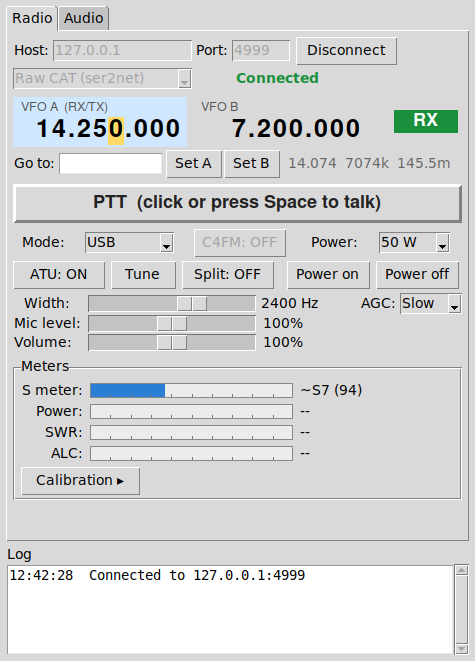
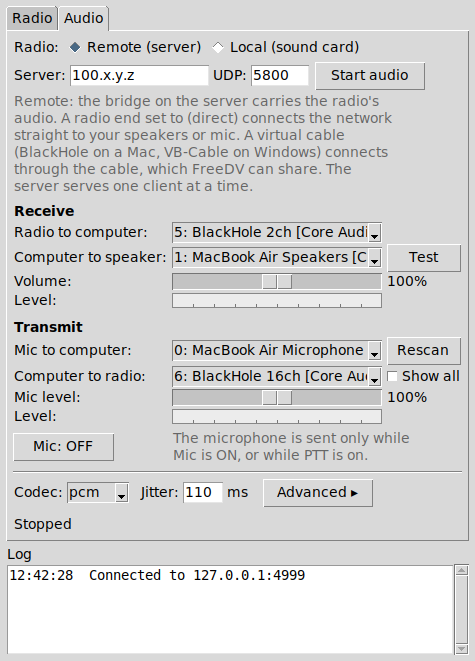

# FT-991A remote station

Tools for operating a Yaesu FT-991A from another computer over a network such as
[Tailscale](https://tailscale.com), or from the same computer:

- **`ft991a_panel.py`** is a compact control panel with a **Radio** tab and an **Audio** tab.
- **`freedv_audio_bridge.py`** is a UDP audio bridge that carries the radio's USB audio and your
  transmit audio, for voice and for [FreeDV](https://freedv.org).

| Radio tab | Audio tab |
| --- | --- |
|  |  |

The screenshots were taken against the simulated radio in this repository.

## What the panel does

**Radio tab**

- VFO A and VFO B side by side. Tune digit by digit with the mouse wheel, or type a frequency.
  Split on and off, and a VFO swap.
- Mode, an FM / C4FM toggle for VHF and UHF, a bandwidth slider, AGC (off, fast, mid, slow, auto),
  power, the internal antenna tuner (in line, and a tune button).
- Push-to-talk: click once to transmit and click again to stop, or press the space bar. It has a
  time-out and lets go when the connection drops or the panel closes.
- Switch the radio on and off remotely.
- S meter, power, SWR and ALC meters, with calibration.
- Mic level and Volume sliders. These are software levels on your computer, and the radio's own
  volume and menu settings are never changed.

**Audio tab**

- FreeDV-style routing: radio to computer, computer to speaker, mic to computer, computer to radio.
- **Local radio**: the radio's sound card is on this computer.
  **Remote radio**: the bridge on the server carries the audio over the network.
- Virtual cables (BlackHole on macOS, VB-Cable on Windows) let FreeDV share the audio, or choose
  "direct" to connect the network straight to your speakers and microphone.
- PCM or Opus, with the bridge's own options under Advanced, plus level meters and statistics
  that show where the audio stops if you hear nothing.

The panel talks to the radio through a raw CAT connection (for example
[ser2net](https://github.com/cminyard/ser2net)) or through Hamlib's `rigctld`. Some features, such
as the bandwidth slider, VFO B and remote power on and off, need the raw CAT connection.

## Quick start

On the radio's computer, make the radio's CAT port reachable (ser2net for raw CAT, or `rigctld`)
and start the audio bridge:

```
python3 freedv_audio_bridge.py list          # shows the audio devices
python3 freedv_audio_bridge.py server --bind YOUR-TAILSCALE-ADDRESS \
    --in-dev "<radio capture device>" --out-dev "<radio playback device>" --wait
```

`freedv-audio-bridge.service` runs the same thing in the background as a systemd user service.

On the operating computer:

```
pip install sounddevice      # for the Audio tab
pip install opuslib          # optional, for Opus (also needs the Opus library)
python3 ft991a_panel.py --host YOUR-RADIO-COMPUTER --port 9000 --backend cat
```

To try the panel without a radio:

```
python3 fake_ft991a.py --port 4533 --demo
python3 ft991a_panel.py --host 127.0.0.1 --port 4533 --backend cat
```

The panel needs only Python 3 and tkinter. The Audio tab also needs `sounddevice`. On Windows,
put a 64-bit `opus.dll` next to `ft991a_panel.py` to use Opus. The panel remembers its settings in
`~/.ft991a_panel.json`.

## Installers (no Python needed)

Ready-to-run versions are built by GitHub's own machines, because a Mac app can only be built on a
Mac and a Windows program only on Windows. Open the **Actions** tab, choose **Build installers**
and click **Run workflow**. It builds, and puts the results in these folders:

- `MacOS/`: `ft-991a-apple-silicon.dmg` and `ft-991a-intel.dmg`.
- `Windows/`: `FT-991A-Panel-Setup.exe` (installer) and `FT-991A-Panel.exe` (program on its own).

Each folder has a README with the details, including how to get past the first-start warnings from
macOS and Windows (the apps are not signed). Every build checks itself before it is published: the
program starts and reports whether Tk, the sound library and Opus are really inside it.

You can also build on your own computer: `bash packaging/build_macos.sh` or
`packaging\build_windows.bat`.

## Files

| File | Runs on | What it is |
| --- | --- | --- |
| `ft991a_panel.py` | the operating computer | The control panel. It is one self-contained file and includes the client side of the audio engine. |
| `freedv_audio_bridge.py` | the radio's computer | The UDP audio bridge: `server`, `client` and `list` modes, PCM or Opus. |
| `freedv_audio_bridge_gui.py` | either | A window for the bridge. It needs `freedv_audio_bridge.py` in the same folder. |
| `freedv-audio-bridge.service` | the radio's computer | systemd user service that runs the bridge server in the background. |
| `radio_power.sh` | the radio's computer | Switches the radio on or off over its CAT port. |
| `freedv_guard.sh` | the radio's computer | Keeps FreeDV's audio device settings from being overwritten. |
| `rigtest.sh`, `nettest.sh` | the radio's computer | Diagnostics for `rigctld` and Hamlib's network client. They never key the transmitter. |
| `udpseq.py` | both ends | UDP packet-loss tester that sends packets the way the bridge does. |
| `wavstat.py` | any | Summarises a bridge debug WAV file: level, continuity and tone frequency. |
| `fake_ft991a.py` | any | A simulated FT-991A for the raw CAT connection. |
| `fake_rigctld.py` | any | A simulated `rigctld`. |
| `Contributions/` | | `opus.dll`, a 64-bit build of the Opus codec library (libopus 1.6.1) for Windows, with its readme. The Windows program and installer use it. |
| `packaging/` | | The recipe and build scripts for the macOS and Windows installers. |
| `.github/workflows/build.yml` | GitHub | Builds the installers. |
| `MacOS/`, `Windows/` | | The finished installers, once built. |

The server and the panel speak the same audio protocol, so either can be updated on its own.

## Safety

- The panel can transmit (PTT, and the tuner's tuning carrier) and it changes radio settings.
  Try everything on a dummy load first.
- Keep the radio's own transmit time-out enabled (menu 036 TX TOT).
- Neither the bridge nor a ser2net or `rigctld` port has a password. Bind them to a private
  network such as Tailscale, and never expose them to the internet.

## Status

Developed against the simulators in this repository. The maintainer has run it against a real
FT-991A over ser2net from macOS: the control panel, remote power on and off, push-to-talk, and
audio in both directions with PCM and Opus. Not yet tested: Windows, and the local-radio audio
mode. Expect rough edges there, and please open an issue with the log and the status text from the
Audio tab.

## Documentation

Each program describes its options in its header comments and with `--help`. A full user manual
(setting up each program, every control, troubleshooting and known issues) is kept as a separate
document and will be added under `docs/`.

## License

MIT. See `LICENSE`.
