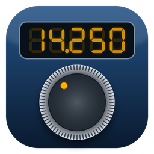
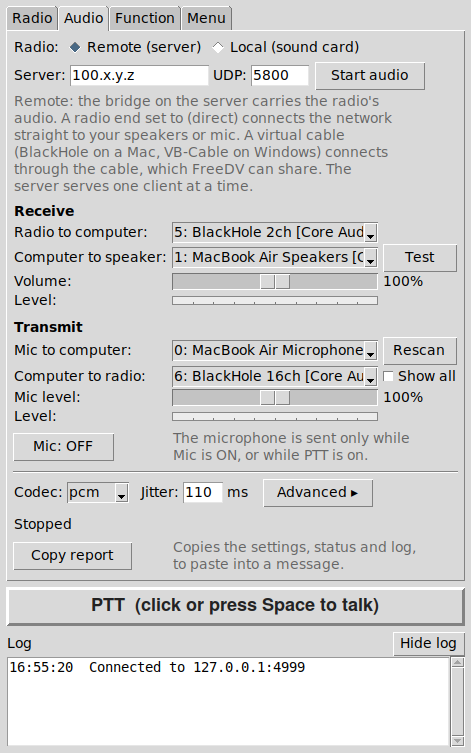
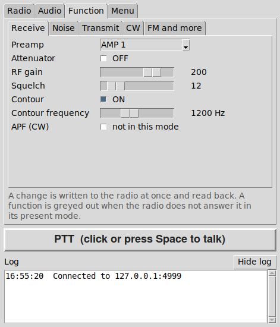
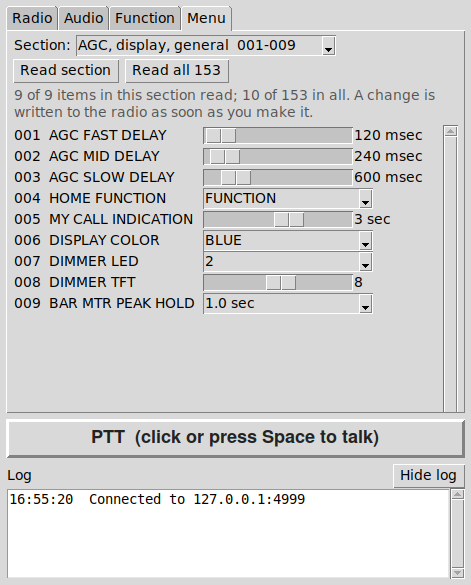

<p align="center"></p>

# FT-991A Companion

Tools for operating a Yaesu FT-991A from another computer over a network such as
[Tailscale](https://tailscale.com), or from the same computer:

- **`ft991a_panel.py`** is a compact control panel with a **Radio** tab, an **Audio** tab, a
  **Function** tab and a **Menu** tab.
- **`freedv_audio_bridge.py`** is a UDP audio bridge that carries the radio's USB audio and your
  transmit audio, for voice and for [FreeDV](https://freedv.org).

| Radio tab | Audio tab |
| --- | --- |
|  |  |

| Function tab | Menu tab |
| --- | --- |
|  |  |

The screenshots were taken against the simulated radio in this repository.

## What the panel does

**Radio tab**

- VFO A and VFO B side by side. Tune digit by digit with the mouse wheel, type a frequency, or pick
  a **Band**: it goes to the last frequency and mode you used on that band (the panel remembers
  them). Split on and off, and a VFO swap.
- Mode, an FM / C4FM toggle for VHF and UHF, a bandwidth slider, AGC (off, fast, mid, slow, auto),
  power, the internal antenna tuner (in line, and a tune button). A light beside the ATU button is
  green when the tuner is off, yellow when it is in line, and flashes while it tunes.
- Push-to-talk, just above the log so that it is on every tab: click once to transmit and click
  again to stop, or press the space bar. It has a time-out and lets go when the connection drops or
  the panel closes.
- Switch the radio on and off remotely.
- S meter, power, SWR and ALC meters, with calibration. The ALC meter is on the radio's own scale
  (green to 25%, orange to 50%, red above). Meters for the audio from the radio and for your
  microphone sit beside them.
- Mic level and Volume sliders. These are software levels on your computer, and the radio's own
  volume and menu settings are never changed.
- **Noise reduction**: a check box, a level from 1 to 20 and an **Auto-calibrate** button. It is
  spectral subtraction on the audio that goes to your speakers (the cable that FreeDV reads is never
  touched). Auto-calibrate retunes to a quiet frequency beside yours, learns the noise there, and
  retunes back; PTT and Tune are refused while it is away. Needs numpy.
- A **Hide log** button, for a shorter window.

**Function tab**

- The radio's front-panel functions in five small pages: **Receive** (preamp, attenuator, RF gain,
  squelch, contour, audio peak filter), **Noise** (noise blanker, the radio's own DNR noise
  reduction, auto and manual notch), **Transmit** (speech processor, mic equalizer, mic gain,
  monitor, VOX), **CW** (keyer, break-in, speed, pitch, delay) and **FM and more** (repeater shift,
  CTCSS tone, dial lock, fast step).
- It reads the page that is showing, so a change made on the radio appears here. Every change is
  read back, a function the radio does not answer in its present mode is greyed out, VOX asks
  before it is turned on, and the mouse wheel never changes a setting. It needs the raw CAT
  connection.

**Menu tab**

- All 153 items of the radio's menu, in 18 sections, read from the radio and changeable: check
  boxes, pull-downs, sliders and entry fields as each item needs. Every change is read back, nothing
  is written while transmitting, and a few risky items (CAT RATE, REF FREQ ADJ ...) ask first.
  It needs the raw CAT connection.

**Audio tab**

- FreeDV-style routing: radio to computer, computer to speaker, mic to computer, computer to radio.
- **Local radio**: the radio's sound card is on this computer.
  **Remote radio**: the bridge on the server carries the audio over the network.
- Virtual cables (BlackHole on macOS, VB-Cable on Windows) let FreeDV share the audio, or choose
  "direct" to connect the network straight to your speakers and microphone.
- PCM or Opus, with the bridge's own options under Advanced, plus level meters and statistics
  that show where the audio stops if you hear nothing. The status line includes the radio's ALC, and
  says so when your audio is sent but is not reaching the radio.
- A **Copy report** button puts the settings, status and log on the clipboard (IP addresses hidden)
  to paste into a bug report.

The panel talks to the radio through a raw CAT connection (for example
[ser2net](https://github.com/cminyard/ser2net)) or through Hamlib's `rigctld`. Some features, such
as the bandwidth slider, VFO B, remote power on and off, and the Function and Menu tabs, need the
raw CAT connection.

## Quick start

On the radio's computer, make the radio's CAT port reachable (ser2net for raw CAT, or `rigctld`)
and start the audio bridge:

```
python3 freedv_audio_bridge.py list          # shows the audio devices
python3 freedv_audio_bridge.py server --bind YOUR-TAILSCALE-ADDRESS \
    --in-dev "<radio capture device>" --out-dev "<radio playback device>" --wait
```

`freedv-audio-bridge.service` runs the same thing in the background as a systemd user service. Add
`--pin-volumes 100` to keep the PulseAudio / PipeWire volumes of the radio's sound card, and of the
bridge's own streams, from being turned down (every correction is logged).

On the operating computer:

```
pip install sounddevice      # for the Audio tab
pip install numpy            # optional, for noise reduction
pip install opuslib          # optional, for Opus (also needs the Opus library)
python3 ft991a_panel.py --host YOUR-RADIO-COMPUTER --port 9000 --backend cat
```

To try the panel without a radio:

```
python3 fake_ft991a.py --port 4533 --demo
python3 ft991a_panel.py --host 127.0.0.1 --port 4533 --backend cat
```

The panel needs only Python 3 and tkinter. The Audio tab also needs `sounddevice`
and the noise reduction needs numpy (without it that one feature is greyed out). On Windows,
put a 64-bit `opus.dll` next to `ft991a_panel.py` to use Opus. The panel remembers its settings in
`~/.ft991a_panel.json`.

## Installers (no Python needed)

Ready-to-run versions are built by GitHub's own machines, because a Mac app can only be built on a
Mac and a Windows program only on Windows. They are on the **Releases** page of this repository,
with the version in the file names:

- macOS: `ft-991a-apple-silicon-<version>.dmg` and `ft-991a-intel-<version>.dmg`.
- Windows: `FT-991A-Panel-Setup-<version>.exe` (installer) and `FT-991A-Panel-<version>.exe`
  (program on its own).

To make a new build, open the **Actions** tab, choose **Build installers** and click **Run
workflow**, leaving the Version box empty (the version is the one in `ft991a_panel.py`). The
finished files are attached to a draft release; publish it to put them on the Releases page.

The `MacOS/` and `Windows/` folders have a README each with the details, including how to get past
the first-start warnings from macOS and Windows (the apps are not signed). Every build checks itself
before it is published: the program starts and reports whether Tk, numpy, the sound library and Opus
are really inside it, and the build stops if the program is not the version in `ft991a_panel.py`.

You can also build on your own computer: `bash packaging/build_macos.sh` or
`packaging\build_windows.bat`.

## Files

| File | Runs on | What it is |
| --- | --- | --- |
| `ft991a_panel.py` | the operating computer | The control panel. It is one self-contained file and includes the client side of the audio engine. |
| `freedv_audio_bridge.py` | the radio's computer | The UDP audio bridge: `server`, `client` and `list` modes, PCM or Opus. |
| `freedv_audio_bridge_gui.py` | either | A window for the bridge. It needs `freedv_audio_bridge.py` in the same folder. |
| `freedv-audio-bridge.service` | the radio's computer | systemd user service that runs the bridge server in the background. |
| `radio_power.sh` | the radio's computer | Switches the radio on or off over its CAT port. |
| `freedv_guard.sh` | the radio's computer | Keeps FreeDV's audio device settings from being overwritten. |
| `rigtest.sh`, `nettest.sh` | the radio's computer | Diagnostics for `rigctld` and Hamlib's network client. They never key the transmitter. |
| `udpseq.py` | both ends | UDP packet-loss tester that sends packets the way the bridge does. |
| `wavstat.py` | any | Summarises a bridge debug WAV file: level, continuity and tone frequency. |
| `fake_ft991a.py` | any | A simulated FT-991A for the raw CAT connection. |
| `fake_rigctld.py` | any | A simulated `rigctld`. |
| `Contributions/` | | `opus.dll`, a 64-bit build of the Opus codec library (libopus 1.6.1) for Windows, with its readme. The Windows program and installer use it. |
| `packaging/` | | The recipe, build scripts and icons (`packaging/icons/`) for the macOS and Windows installers. The version number lives in `ft991a_panel.py`. |
| `.github/workflows/build.yml` | GitHub | Builds the installers. |
| `MacOS/`, `Windows/` | | A README for each installer. The installers themselves are on the Releases page. |

The server and the panel speak the same audio protocol, so either can be updated on its own.

## Safety

- The panel can transmit (PTT, and the tuner's tuning carrier) and it changes radio settings.
  Try everything on a dummy load first.
- Keep the radio's own transmit time-out enabled (menu 036 TX TOT).
- Neither the bridge nor a ser2net or `rigctld` port has a password. Bind them to a private
  network such as Tailscale, and never expose them to the internet.

## Status

Version 1.0.6 (see `CHANGELOG.md`).

Developed against the simulators in this repository. The maintainer has run it against a real
FT-991A over ser2net from macOS: the control panel, remote power on and off, push-to-talk, and
audio in both directions with PCM and Opus,  and the local-radio audio mode. The Function tab, the 
Band pull-down and the noise reduction have also been tested and seem to function within normal 
operating parameters.  Not yet tested under Windows. Expect rough edges there, and please open 
an issue with the log and the status text from the Audio tab.

## Documentation

Each program describes its options in its header comments and with `--help`. A full user manual
(setting up each program, every control, troubleshooting and known issues) is in `Documentation/`.

## License

MIT. See `LICENSE`.
